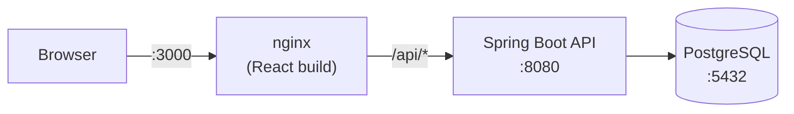
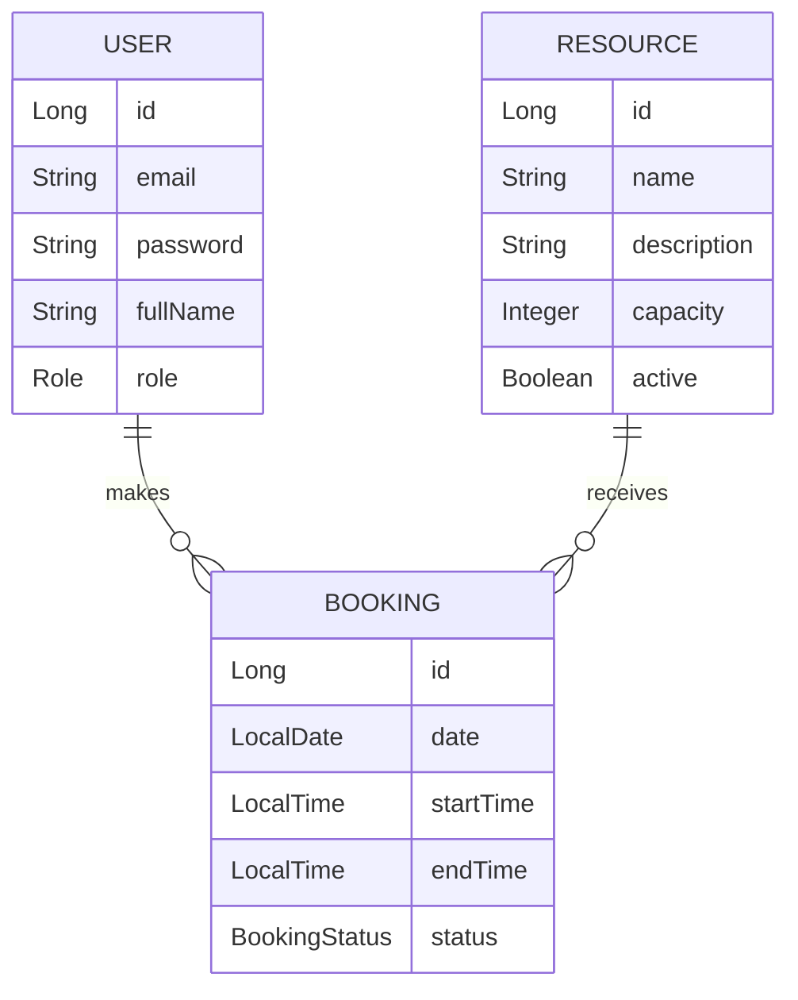

# BookingManager

Meeting room booking system with a **Spring Boot REST API**, **JWT authentication with roles**, a **React** frontend and a fully dockerized environment.

A portfolio project built to showcase a complete Java backend (security, persistence, business rules, error handling and testing) consumed by a real frontend and runnable with a single command.

## Features

- Sign-up and login with **JWT** (no server-side sessions).
- Two roles: `USER` and `ADMIN`.
- **Users:** browse rooms, book a time slot, view their bookings and cancel them.
- **Admins:** create, edit and deactivate rooms, and view or cancel any booking.
- **Overlap validation:** a room cannot be booked for a time slot that conflicts with another confirmed booking (the API responds with `409 Conflict`).
- Consistent JSON error responses with the appropriate HTTP status code in each case.
- API documented with **Swagger UI / OpenAPI**.

## Tech stack

| Layer | Technologies |
|---|---|
| Backend | Java 21, Spring Boot (Web, Data JPA, Security, Validation), Hibernate |
| Security | Spring Security, JWT (JJWT), BCrypt |
| Database | PostgreSQL 16 |
| Frontend | React (Vite), React Router, Axios, plain CSS with automatic dark mode |
| Documentation | springdoc-openapi (Swagger UI) |
| Testing | JUnit 5, Mockito, AssertJ |
| Infrastructure | Docker, Docker Compose, nginx |

## Architecture



nginx serves the frontend and forwards everything starting with `/api` to the backend. From the browser's point of view, the UI and the API share the same origin, so no CORS configuration is needed in production.

### Data model



## Running with Docker

Requirements: **Docker** and **Docker Compose**.

```bash
# 1. Clone the repository
git clone <repository-url>
cd <project-folder>

# 2. Create the environment file from the template
cp .env.example .env
#    Edit .env and set a long, random JWT_SECRET (at least 32 characters).
#    You can generate one with: openssl rand -base64 48

# 3. Build and start the three services
docker compose up --build -d
```

| Service | URL |
|---|---|
| Web application | http://localhost:3000 |
| REST API | http://localhost:8080/api |
| Swagger UI | http://localhost:8080/swagger-ui.html |

To shut everything down: `docker compose down` (add `-v` to also delete the database data).

### Creating an admin user

For security reasons, public sign-up always creates users with the `USER` role. To promote an account to `ADMIN`:

```bash
docker exec -it meeting-room-db psql -U postgres -d meeting_room_booking \
  -c "UPDATE users SET role='ADMIN' WHERE email='you@email.com';"
```

Log out and log back in so the interface shows the admin options.

## Local development

Run only the database in Docker and start the backend and frontend from your IDE:

```bash
# Database
docker compose up -d postgres

# Backend (from IntelliJ IDEA or with Maven)
mvn spring-boot:run

# Frontend
cd frontend
npm install
npm run dev        # http://localhost:5173
```

In development, Vite proxies `/api` to `localhost:8080`, so the frontend code is the same as in Docker.

## REST API

The full interactive reference is available in Swagger UI. Summary:

| Method | Endpoint | Access | Description |
|---|---|---|---|
| POST | `/api/auth/register` | Public | Register a user and get a token |
| POST | `/api/auth/login` | Public | Log in and get a token |
| GET | `/api/resources` | Authenticated | List active rooms |
| POST | `/api/resources` | ADMIN | Create a room |
| PUT | `/api/resources/{id}` | ADMIN | Update a room |
| DELETE | `/api/resources/{id}` | ADMIN | Deactivate a room |
| POST | `/api/bookings` | Authenticated | Create a booking (validates overlaps) |
| GET | `/api/bookings/me` | Authenticated | List the user's own bookings |
| GET | `/api/bookings` | ADMIN | List all bookings |
| DELETE | `/api/bookings/{id}` | Owner or ADMIN | Cancel a booking |

Protected routes expect the header `Authorization: Bearer <token>`.

### Example

```bash
# Log in
curl -X POST http://localhost:8080/api/auth/login \
  -H "Content-Type: application/json" \
  -d '{"email":"you@email.com","password":"your-password"}'

# Book a room
curl -X POST http://localhost:8080/api/bookings \
  -H "Authorization: Bearer <token>" \
  -H "Content-Type: application/json" \
  -d '{"resourceId":1,"date":"2026-10-05","startTime":"10:00","endTime":"11:00"}'
```

## Business rules

1. The start time must be earlier than the end time.
2. An inactive room cannot be booked.
3. Two confirmed bookings for the same room cannot overlap. Back-to-back bookings (one ends at 10:00 and the next starts at 10:00) are valid.
4. A user can only cancel their own bookings; an `ADMIN` can cancel any booking.
5. Cancellations and deactivations are logical: the record is kept with its new status.

## Project structure

```
.
├── src/main/java/com/project/bookingmanager
│   ├── config/         # Security, CORS and OpenAPI
│   ├── controller/     # REST endpoints
│   ├── dto/            # Request/response objects
│   ├── exception/      # Business exceptions and global handler
│   ├── model/          # JPA entities and enums
│   ├── repository/     # Spring Data repositories
│   ├── security/       # JWT filter, token utilities and UserDetails
│   └── service/        # Business logic
├── src/test/java/...   # Unit tests
├── frontend/           # React app (Vite) + nginx.conf
├── Dockerfile          # Backend image (multi-stage)
├── docker-compose.yml  # Database, API and frontend
└── .env.example        # Environment variables template
```

## Testing

```bash
mvn test -Dtest=BookingServiceTest
```

Unit tests for the booking service using JUnit 5 and Mockito: successful booking, overlaps, invalid time ranges, inactive room, missing resources and permission rules when cancelling.

## Technical decisions

- **Stateless authentication:** JWT in the `Authorization` header and `SessionCreationPolicy.STATELESS`; that is why CSRF is disabled.
- **Passwords** are stored as BCrypt hashes.
- **Two-level authorization:** route-based rules in `SecurityConfig` and method-level rules with `@PreAuthorize`.
- **Centralized error handling** with `@RestControllerAdvice`: the service throws business exceptions and a single component maps them to HTTP status codes.
- **Configuration through environment variables:** credentials and the JWT secret stay out of the code; `.env` is not versioned.
- **Multi-stage Docker images:** Maven and Node exist only in the build stage; the final backend image uses a JRE and the frontend image uses nginx.
- **The database must be ready** (`healthcheck` + `depends_on`) before the backend starts.

## Known limitations and future improvements

- Responses expose entities directly (the password hash is hidden with `@JsonIgnore`); response DTOs would be the proper solution.
- The schema is generated by Hibernate (`ddl-auto=update`); a real environment would use Flyway migrations.
- Checking for overlaps and then saving is not an atomic operation: two simultaneous requests could book the same time slot. This could be solved with a pessimistic lock on the room or a PostgreSQL exclusion constraint.
- The token is stored in `localStorage` and there are no refresh tokens; an `HttpOnly` cookie would be more robust against XSS.
- Repository integration tests with Testcontainers.

## Author

**Hector Trujillo**

- GitHub: [@hectormtc8](https://github.com/hectormtc8)
